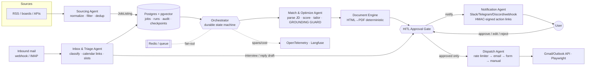

# JobAgent — multi-agent job search & application system with human-in-the-loop

Runnable reference implementation plus production blueprint. **Nothing is ever sent without explicit human approval, and `DRY_RUN=1` is the default.**

```bash
cd ~/job-agent
python3 run.py                          # dashboard + API on http://127.0.0.1:8000  (dry-run: sends nothing)
DRY_RUN=0 python3 run.py                # really send approved email applications
python3 -m unittest discover -s tests -t .   # hermetic: never reads your .env
```

## What it does today
| Stage | Implementation |
|---|---|
| **Find jobs** | **Refresh jobs** (or scheduled every N hours) pulls from: remote boards (Remotive, RemoteOK, We Work Remotely); **company career sites** via public Greenhouse/Lever/Ashby APIs (editable watchlist); and **LinkedIn / Naukri / Glassdoor alert emails** already in your Gmail - never by scraping those sites. Location, work-mode, company and keyword filters; cross-source dedup. |
| **Match & tailor** | Every job is scored instantly; the best N are tailored automatically (local Ollama model, Claude, or rules), the rest wait in *Discovered* with a Tailor button. Tone presets; "Regenerate with feedback". Every result passes the **grounding guard**. |
| **Review** | Each job opens as a full page: job description with matched/missing keywords highlighted, tailored resume with changes highlighted vs. your master resume, editable cover letter, match breakdown, history. |
| **Send** | Email jobs: Gmail API, PDF attached, rate-limited, at-most-once. Form-only jobs: **assisted pre-fill** - you press Submit. Optional **Autopilot** (off by default): email-only, above a score threshold, daily cap. |
| **Track** | Applications view with follow-up reminders; applications you made elsewhere are **imported from confirmation emails**; replies move applications to interview/closed. |
| **Inbox** | Job-related Gmail only: interview / screening / rejection / confirmation, recruiter name + company, Zoom/Meet/Teams/Calendly links, proposed slots. Newsletters dropped and never stored. |
| **Profile** | Upload a PDF/DOCX/TXT resume in the app: parsed (local model or rules), every fact checked against the file, reviewed, then saved - which **re-scores every open job and re-tailors the best**. Full profile editor. |
| **Insights** | Skill-demand vs. your profile (gap analysis), application funnel, 3-week activity, sources, match-score and salary distributions - each with hover tooltips and a table view. |
| **Assist** | AI reply drafts for recruiter mail (sent in-thread only when you click Send; placeholders block sending); interview prep kits mapped to your real bullets; salary ranges on cards + minimum-salary filter; ⌘K command palette. |
| **Save any job** | Bookmarklet (Settings › Gmail & sending) or **Add a job**: reads the posting's JSON-LD / page text in your browser and opens `/clip` (data travels in the URL fragment, never logged); dedups; can prepare the application right away. |
| **Interviews** | Schedule (times, meeting and booking links suggested from the recruiter's email), `.ics` calendar file, desktop reminder an hour before, thank-you drafts (placeholders block sending; sent in the recruiter's thread). |
| **Practice** | Mock-interview answers with timer and dictation; STAR / metrics / filler feedback that cites your real bullets. |
| **Offers** | Side-by-side comparison with your own weights, market check against salaries in your job list, negotiation email from a template: every number comes from you, and a competing offer is mentioned only if it is really higher, never by name. |
| **Resume health** | ATS-style score with specific fixes; suggested bullet rewrites are rejected if they add numbers or tools; add evidenced skills in one click; learning plan for top gaps. |
| **Habits** | Weekly goal + streak, pre-send checklist (placeholders block; a second application to the same company within 120 days warns), notes & stars, resume / cover-letter PDF downloads, daily summary email to yourself, JSON export (no secrets). |
| **Outreach** | Email recruiters and hiring managers directly. **You find the person** (LinkedIn search opens in your own browser - never scraped; emails are never guessed) and add them; a personal email and a CV tailored to the posting are written from your real profile (same no-invention guard). You approve each email; **Send all approved** sends them one at a time, ~1 min apart, under a daily cap (default 10). Tracker: to review / approved / sent / replied / interview, reply detection from your Gmail, one follow-up after 5 days. Safeguards: opt-out line in every email, one email per person per 30 days, max 2 people per company, a "no" or "unsubscribe" is never contacted again, no tracking pixels. |
| **Look & feel** | **Command center** (`static/deck.css` is the only stylesheet; `static/fx.js` is the effects layer; one typeface, Archivo; no front-end dependencies). Dark by default (light one click away), navy and blue-black with the gold brand accent kept for primary actions, important numbers and active states, cyan for system state. **Composition:** sections are separated by space, type and light rather than boxes; a floating glass **sidebar** rail (icons, opens on hover, pin it with the top-left button or `[`); a top bar that dissolves into the background until you scroll. **Dashboard:** an editorial greeting, a short **briefing** (sentences worked out from your own counts and trends, nothing generated), the pipeline drawn as a **route** with a live number at each stop (a plane flies to your furthest stage; hover a stop to light the path to it; numbers count to their new value when they change), a **priority feed** that says why each item matters and opens to show what is behind it, and a swipeable **stream of opportunity cards**. **Jobs:** cards by default (Cards / Table / Board): company, a large match score, a one-sentence reason from the verdict logic (`/api/insights/jobs`), location and pay, and a “Why” expander with the strengths and gaps; a company's other openings fold under its card; the table remains for sorting and bulk work. **Effects:** a light follows the pointer along card edges, cards lean toward the pointer, the main buttons have a sheen and a slight pull, the sidebar marker and tab underline glide, a job's title travels from its card into the record, content reveals on scroll. **Motion level** (Settings › Accessibility): *Full*, *Calm* or *Off*; system reduced-motion always wins. Only transforms and opacity animate, and nothing runs script-driven frames at rest. **Landing page** (`/welcome`): night-sky route map, product shown in depth, scroll-driven steps. Earlier front ends are in `backups/`. |
| **Decide & tailor** | Per job: a **Should I apply?** verdict (years asked vs. yours, covered and missing skills, location, salary floor) and a **keyword report** limited to real skills and technical terms (`agents/market.py`). **Resume versions** (one per kind of role, each with its own preferences; per-job override) and four single-column **templates**. **Salary explorer** from pay stated in listings seen (needs 3+ to quote a range) with link-outs. **People** tracker (referrals, notes, follow-up dates) and a **LinkedIn profile review** on pasted text, with rewrites assembled from the saved resume. |
| **Browser extension** | `extension/` (Chrome MV3, load unpacked): fills contact details and an optional prepared cover letter on application pages via `/api/autofill`. Fills empty fields only; never submits, uploads files, or answers salary/visa/demographic/consent questions (same rules as `agents/formfill.py`). |
| **Assistant** | The **Ask** button opens a chat that knows every feature. Answers come from a built-in guide (`agents/assistant.py`, one entry per capability - update it when features change): clear matches are answered instantly, other questions go to the configured model, which may only use the guide and a live status snapshot (its reply is discarded if it cites unknown topics or numbers). "What should I do next?" is answered from your own data. Each answer has buttons that open the right page. |
| **Accounts** | Connect, switch or disconnect Gmail from Customize (OAuth with PKCE; switching clears the old inbox cache; disconnect revokes at Google). |
| **Customize** | Titles, locations, work modes, exclusions, minimum match, auto-tailor count, tone, sources on/off, company watchlist, refresh schedule, follow-up days, autopilot. |

### Config (`.env`, chmod 600 - never commit)
`GMAIL_CLIENT_ID/SECRET/REFRESH_TOKEN` (mint with `scripts/gmail_auth.py`; scopes: send + read-only), `JOBAGENT_LLM=ollama|claude|0`,
`OLLAMA_MODEL`, `ANTHROPIC_API_KEY`, `INBOX_POLL`, `DRY_RUN`, `DASHBOARD_TOKEN`, `MATCH_THRESHOLD`, `MAX_EMAILS_PER_HOUR`.
Load your profile with `python3 scripts/load_profile.py profile.json`.

### Known limits
- Google apps in *Testing* mode expire refresh tokens after 7 days - publish the consent screen (stays private) to avoid it.
- Public feeds are remote-focused; there is no legitimate free feed for India on-site roles (LinkedIn/Naukri/Indeed forbid scraping).
- Local 7B model writes plainer cover letters than Claude (~50 s per job); edit in the dashboard.
- Form filling is assisted by design: CAPTCHAs, salary/visa/demographic questions are always left to you.

## 1. Architecture



**Run state machine** (`jobagent/orchestrator.py`):
`discovered → scored → (skipped | tailored → awaiting_approval) → approved → submitting → (submitted | needs_manual)`; `awaiting_approval → rejected`; inbound mail moves `submitted → interview | closed`.
The graph has **no edge** from `tailor` to `dispatch` that skips the gate, and `n_dispatch` re-checks `status == APPROVED` (defence in depth). A checkpoint is written after each node; `recover()` resumes crashed runs. `SUBMITTING` is deliberately **not** auto-recovered (at-most-once delivery — a crash mid-send goes to a human rather than risking a duplicate application).

**Shared state** lives in `jobagent/schemas.py`: `JobListing`, `JDRequirements`, `ResumeAdaptation`, `ApplicationRun`, `InboundEmail`, `AuditEvent`, `CandidateProfile`. Agents exchange only these types (bounded contexts; no agent touches another's internals).

## 2. Tech stack decisions

| Concern | Dev (this repo) | Production recommendation | Why |
|---|---|---|---|
| Orchestration | Custom checkpointed state machine | **Temporal** for durable, long-waiting workflows (human approval can take days, retries/timeouts native); LangGraph *inside* agent nodes for LLM sub-flows | CrewAI's role-play model lacks durability/HITL guarantees. The `GRAPH` dict maps 1:1 onto Temporal activities + a `wait_condition` signal for approval. |
| DB / vectors | SQLite, hashed-BoW embeddings | **PostgreSQL + pgvector** (single store: relational audit + ANN) | One transactional system; avoids sync bugs with a separate vector DB at this scale |
| Queue | In-process | **Redis Streams** (or Temporal task queues); RabbitMQ only if you need complex routing | Simple, per-domain rate-limit counters live there too |
| Browser | Playwright stub | **Playwright** (+ `Crawl4AI` for JD scraping); per-ATS adapters (Greenhouse/Lever/Ashby/Workday) | Deterministic selectors beat LLM-driven clicking for reliability/cost; LLM only as fallback field-mapper |
| Documents | HTML (+WeasyPrint if installed) | **Jinja2 → Typst** or WeasyPrint; single column, no tables/images/icons | Byte-deterministic builds, ATS-parsable text layer |
| LLM | `RuleTailorer` (deterministic) behind `Tailorer` protocol | Claude via structured output into `ResumeAdaptation`, always passed through `verify_grounded` | Model can't weaken safety; guard is model-independent |
| Secrets | Env vars | **Vault / AWS Secrets Manager**, per-user KMS envelope encryption for resumes & OAuth tokens | |
| Observability | Audit table | **OpenTelemetry** traces (`run_id` as trace attribute) + **Langfuse** for token/cost | |

## 3. Implementation roadmap

1. **Ingestion & parsing** — `agents/sourcing.py`: adapter protocol, fingerprint dedup across boards (`company|title|location` hash), preference filters, one failing source never stops the sweep. *Next:* board-specific adapters honoring robots.txt/ToS, canonical-URL + embedding-based near-dup detection, nightly profile re-embedding.
2. **Tailoring & documents** — `agents/matcher.py`, `documents.py`: JD → must/nice/keywords, hybrid score (0.35 semantic + 0.65 must-have coverage), select/reorder real bullets, cover letter, **grounding guard**, deterministic HTML/PDF. *Next:* LLM `Tailorer` with JSON-schema output; golden-file tests for PDF determinism; ATS parse check (round-trip the PDF through a parser and diff fields).
3. **Dispatch** — `agents/dispatch.py`: ordered channels (email → form → manual), sliding-window persisted rate limits, exponential backoff only for `Transient`, `Blocked` never retried (falls through), terminal `NEEDS_MANUAL`. *Next:* Gmail API `users.messages.send` via OAuth2 with `gmail.send` scope only; per-ATS Playwright adapters; screenshot + DOM snapshot stored per attempt.
4. **Inbound** — `agents/triage.py`: rule classifier (rejection > interview > screening > ack), Calendly/Zoom/Meet link + slot extraction, idempotent on provider message-id, auto-links to runs and advances status. *Next:* Gmail push (Pub/Sub watch) / Graph webhooks; LLM classifier for low-confidence rule misses; reply drafts routed through the same approval gate.
5. **Notify & HITL UI** — `agents/notify.py`, `static/index.html`: Slack Block Kit payload, HMAC-signed expiring approve/reject links, local dashboard with resume preview (sandboxed iframe), editable cover letter, audit trail. *Next:* Slack interactivity endpoint (verify `X-Slack-Signature`), Telegram inline keyboards.

## 4. Key code (all runnable, in repo)
- Orchestrator graph: `jobagent/orchestrator.py`
- Resume-vs-JD schema + guard: `jobagent/schemas.py::ResumeAdaptation`, `jobagent/agents/matcher.py::verify_grounded`
- Blocked/failed submission fallback: `jobagent/agents/dispatch.py::dispatch_with_fallback`
- Tests proving the safety properties: `tests/test_system.py`

## 5. Stealth, safety & compliance stance
IP rotation, stealth plugins and CAPTCHA-solving services are **intentionally not implemented**. Defeating bot walls violates most boards' ToS and is the fastest route to an account ban; the design treats a challenge as a signal to stop (`Blocked` → next channel → human). Sustainable alternatives: human-paced limits (≤20 apps/day, jittered delays), a real logged-in user session reused from the operator's own browser profile, official APIs/email where available, and handing CAPTCHAs to the user in the dashboard. Email reputation: send from the user's own mailbox via OAuth (inherits their SPF/DKIM/DMARC alignment), ≤5/hour, never bulk, one message per job, `Reply-To` = user.

Security: API bearer token, HMAC-signed single-purpose links with expiry, all UI output HTML-escaped, resume preview in a `sandbox` iframe, PII never logged (audit stores ids/decisions, not resume text). Production: per-tenant row-level security, encrypted blobs, Vault-issued short-lived OAuth tokens.

## 6. Failure modes & mitigations

| Failure | Detection | Mitigation |
|---|---|---|
| CAPTCHA / bot wall | Selector for captcha frames, HTTP 403/429 | Raise `Blocked`; no retry; fall to next channel; else `NEEDS_MANUAL` with deep link in dashboard |
| Multi-step screening questions | Unmapped required fields / new page after submit | Stop, snapshot, surface questions to user; answers saved to a reusable Q&A bank (user-authored only) |
| LLM hallucinated skills/years/bullets | `verify_grounded` (skill set, bullet provenance, new tech/number tokens, "N years" claims) | Retry ≤2, then run `FAILED` — never shown as sendable |
| Email rate limit / reputation | `RateLimited` from persisted sliding window; provider 429 | Defer to next window; escalate after N defers |
| Duplicate applications | Fingerprint dedup; `start()` idempotent per job; single-use gate | One run per job; double-approve returns 409 |
| Crash mid-send | Run stuck in `SUBMITTING` | Not auto-retried (at-most-once); flagged for human reconciliation |
| Crash mid-pipeline | Checkpoint + non-terminal status | `recover()` on startup |
| Board markup change / source outage | Exceptions in adapter | Isolated per source, audited, sweep continues |
| Misclassified email | Rule conflicts (ack+rejection) | Priority ordering; low-confidence → LLM/human; auto-status changes are audited and reversible |
| Replayed/forged approval link | HMAC + expiry + state check | 403 / 409 |
| Notification provider down | Delivery exception | Logged; dashboard is the source of truth |
| Stale profile / wrong facts | — | Profile is the only fact source; edits versioned in audit |
| Cost runaway | Token/cost metrics | Per-run budget, circuit breaker on LLM spend |
